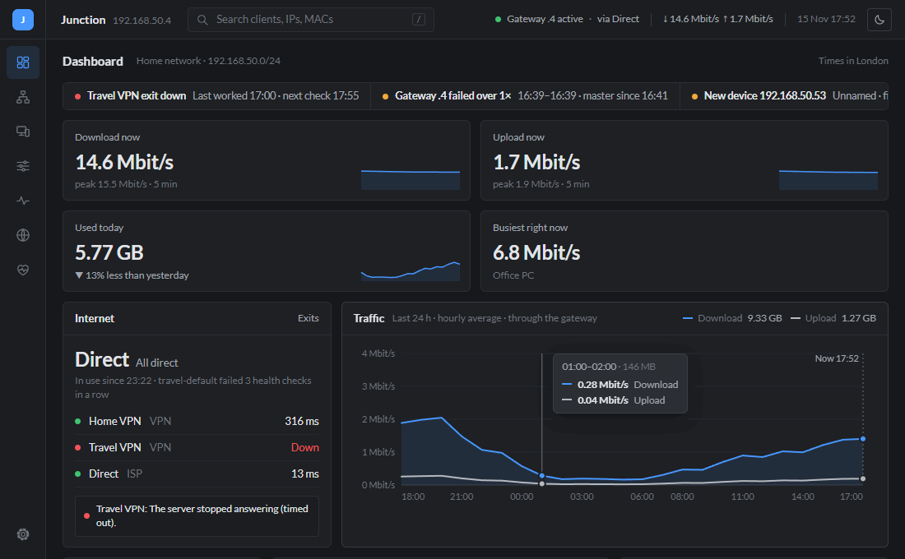
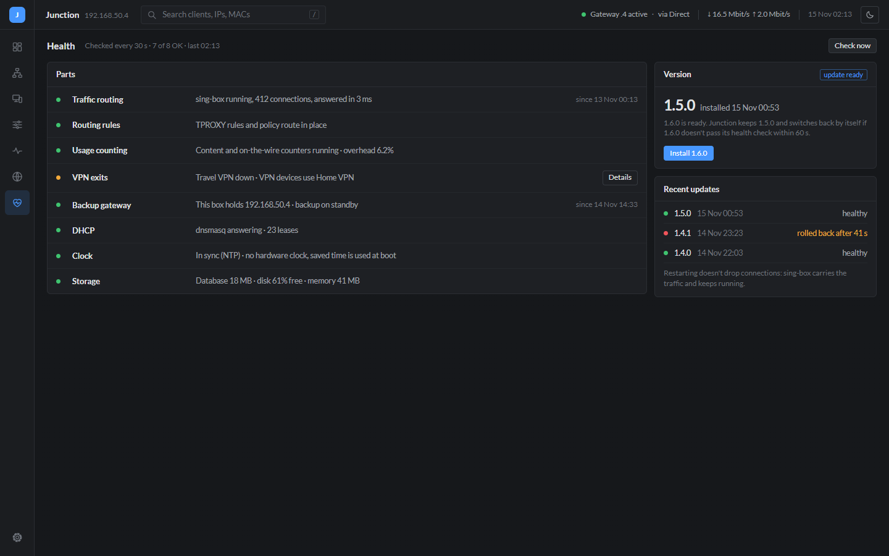
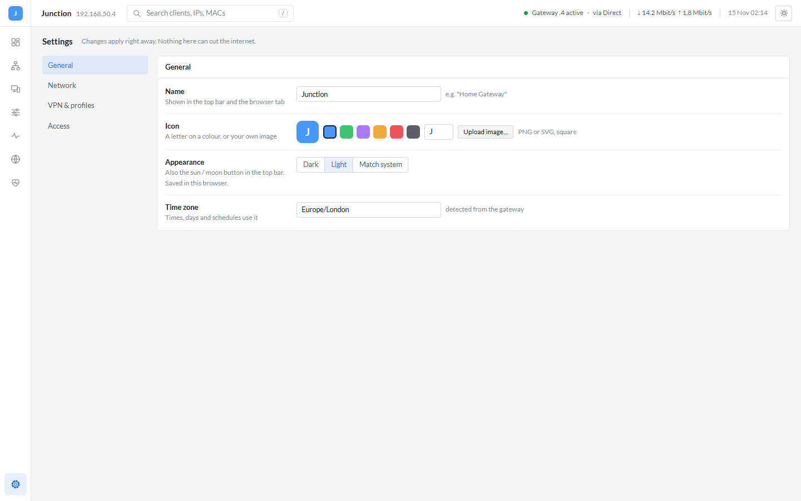

<!-- SPDX-License-Identifier: GPL-3.0-or-later -->
# Junction

**See and steer every device on your home network, from one page.** Junction turns a small Linux box (a Raspberry Pi, an old PC, a VM or a Proxmox container) into your network's gateway. Every device that uses it shows up with what it's doing, and you decide, per device or per group, whether it goes out directly or through a VPN, how fast it may go, how much it may use, and when it's paused.



## What it does

- **Usage per device, group and site:** live, per hour, day and month. Traffic between devices at home is never counted, only the internet.
- **Your bundle, counted like your ISP counts it:** whole packets, headers included, so "left" matches your provider's number to within a fraction of a percent. Log a renewal when you top up, and correct "what's left" whenever you check your ISP's app.
- **VPN per device or group:** send just the console through the VPN, keep everything else direct. Several exits with automatic failover between them.
- **Rules:** pause at bedtime, slow a device down after 5 GB a day, put a group on a profile, with schedules and one-tap "skip this time".
- **Health at a glance:** every part (routing, rules, counting, VPN exits, DHCP, clock, storage) with a plain-language status, plus safe updates that roll back by themselves.
- **Yours:** name and icon of your choice, light or dark, optional password, works on a phone.

| | |
|---|---|
|  |  |

## It never cuts your internet

Junction is built to fail open:

- Traffic is carried by [sing-box](https://sing-box.sagernet.org). Junction only reads it and tells it what to do. If Junction stops, crashes or is being updated, traffic keeps flowing.
- The gateway's routing rules are only hooked in while sing-box is healthy. If sing-box itself fails, devices go out directly (without the VPN) until it's back.
- Optional: a second box can hold the gateway address with keepalived and take over within seconds.
- Updates keep the previous version and switch back automatically if the new one doesn't pass its health check.

## Install

```sh
curl -fsSL https://github.com/XIVIX134/junction/releases/latest/download/install.sh | sudo sh
```

Then open `http://<the box's address>/` and follow the setup. Full guide (Raspberry Pi, Debian/Ubuntu, Alpine, Proxmox, and how to point your devices at the gateway): [packaging/README.md](packaging/README.md).

Requirements: Linux on amd64, arm64 or armv7 (Raspberry Pi 3 and newer), wired Ethernet, and a fixed address.

## How it works

```
devices ──> gateway box ──────────────────────────────> your router ──> internet
            ├─ sing-box: TPROXY inbound, per-device rule-sets, exits (direct / VPN)
            ├─ junctiond: the web app, counters, rules engine, failover
            └─ optional: dnsmasq (DHCP), keepalived (backup gateway)
```

`junctiond` is one static binary with the web app embedded (Go + React, SQLite). It reads connections from sing-box's API, counts whole packets with two counting-only firewall chains, and writes the small rule-set files sing-box reloads by itself. The API is documented in [API.md](API.md).

## Docs

- [Install guide](packaging/README.md): Raspberry Pi, Debian/Ubuntu, Alpine, Proxmox, and pointing your devices at the gateway
- [How it compares](docs/comparison.md) with Pi-hole, OpenWrt, Firewalla and pfSense
- [FAQ](docs/faq.md) and [troubleshooting](docs/troubleshooting.md)
- [Configuration](docs/configuration.md): every key in `config.json`, including VPN exits and failover
- [API](API.md)

## Development

```sh
cd web && npm ci && npm run dev:mock   # the UI on sample data
go test ./...
./build.sh                             # ./out/junctiond for linux/amd64
scripts/release.sh                     # release tarballs for amd64, arm64, armv7
```

See [CONTRIBUTING.md](CONTRIBUTING.md).

## License

GPL-3.0-or-later. See [LICENSE](LICENSE).
